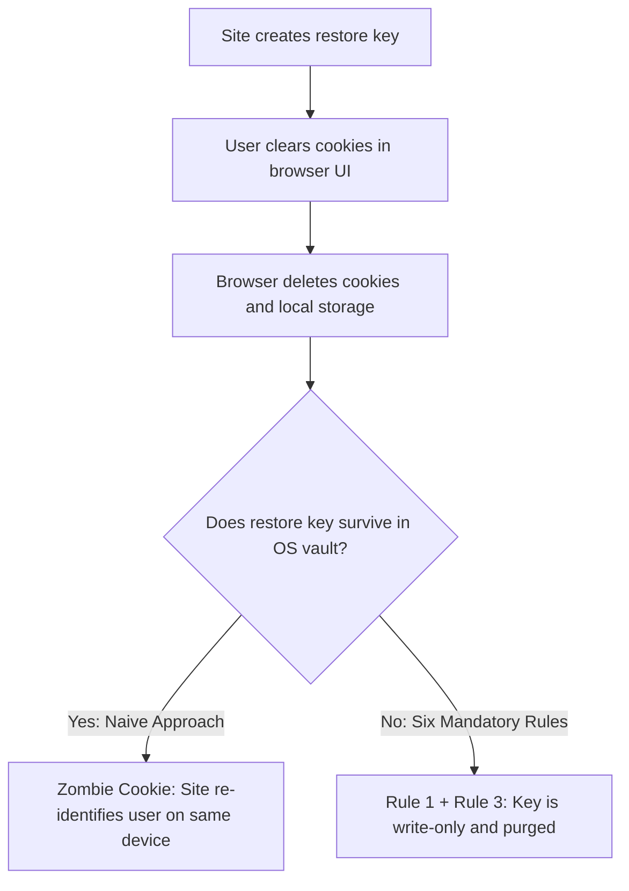

# Installed Web App Session Restore Explainer

**Authors:** [Dan Murphy](https://github.com/dmurph) (Google)  
**Participate:** [GitHub Issues](https://github.com/dmurph/cross-device-web-app-session-restore/issues)  
**Target Venue:** W3C Web Incubator Community Group (WICG) / Web Authentication WG / WebAppSec WG  
**Proposed Specification:** Credential Management Level 2 / Web Authentication Level 3 Extension and DBSC Integration

## Explainer Suite
1. **Core Explainer (This Document):** Covers problem scope, the alignment gate, six mandatory rules, prior art, and candidate architectures.
2. **[Track 1: Dedicated `RestoreCredential` (and Passkey Alternatives)](track1-restore-credential.md):** Covers Dedicated `RestoreCredential` (Option 1B), considered passkey-extension alternatives (Option 1A), WebIDL, JS flows, FIDO2 flags, and WPT tests.
3. **[Track 2: Declarative DBSC Restore](track2-dbsc-session-restore.md):** Covers the network-stack `Sec-Session-Migrate` protocol, escrow lifecycle, and HTTP test ergonomics.
4. **[Security & Privacy Questionnaire](SECURITY_PRIVACY_QUESTIONNAIRE.md):** Covers the W3C TAG Security and Privacy Self-Review.

## 1. Summary & Core User Journey
When a user sets up a new device or resets a device, the operating system restores their installed web apps. These apps include Progressive Web Apps, [Trusted Web Activities (TWAs)](https://developer.chrome.com/docs/android/trusted-web-activity), WebAPKs, iOS WebClips, and Store PWAs. TWAs, WebAPKs, and desktop installed PWAs share the browser's cookie jar and site storage. Therefore, they share login and logout state with the browser. Native apps restore signed-in states automatically using APIs like [Android `RestoreCredential`](https://developer.android.com/training/sign-in/restore-credentials) or [Apple Keychain](https://developer.apple.com/documentation/security/keychain-services). Installed web apps launch logged out because browsers never copy raw cookies across devices.

A user gets a new phone or resets their laptop. During device setup, the system asks: "Restore your apps and stay signed in?"

When the user approves, the app signs in automatically without passwords or MFA prompts.

This proposal scopes session restore strictly to installed web apps for three critical reasons:

1. **Session Persistence Expectations:**
   Browsers aggressively expire cookies on casual sites. Users expect installed web apps to stay signed in across device transfers. For example, iOS 16.4+ exempts Home Screen WebClips from the 7-day storage cap.

2. **User Transparency & Dark Pattern Defense:**
   Past web auto-sign-in features caused unwanted logins during normal browsing. Tying restore strictly to installed app setup provides a clear opt-in moment. The user gets full visibility into which app and account will restore.

3. **Developer Retention on the Open Web:**
   App stores expect store-distributed apps to restore sign-in state on new devices. Many store-distributed web apps lack this feature. A privacy-preserving web standard prevents developers from abandoning the Open Web.

## 2. The Alignment Gate & Non-Goals
Standards reviewers must resolve two foundational questions:
1. Should the Web Platform allow an installed web app to restore its signed-in session on a new device?
2. Do we agree on these six mandatory rules?

* **Rule 1 (Write-Only on Source Device):**
  The browser blocks reading a restore key on the source device. This rule prevents same-device supercookies after a user clears cookies.

* **Rule 2 (One-Time Silent Read per Device Restore):**
  The target device allows only one silent read per OS restore event. After that read, the browser revokes silent access on the target device so the key cannot act as a supercookie. User agents and servers may keep the key in cloud backup to restore additional devices (until deleted under Rule 3) or rotate it per transfer.

* **Rule 3 (Strict Fate-Sharing with Site Data & Logout):**
  Because installed web apps share state with the browser, a restore key is browsing data partitioned by browser and profile. If the user clears site data or logs out ([`Clear-Site-Data`](https://www.w3.org/TR/clear-site-data/) or [`Set-Login: logged-out`](https://w3c-fedid.github.io/login-status/)), the browser and server delete the key. This prevents silent re-login on both the same device and a newly restored device.

* **Rule 4 (Authenticated Top-Level Context Only):**
  Only an authenticated top-level origin (`Set-Login: logged-in`) for an installed web app can register a restore key. Cross-origin iframes cannot call the API.

* **Rule 5 (Explicit User Restore Consent):**
  The target device releases a restore key only if the user consented to restore the app during device setup or first launch.

* **Rule 6 (Hidden from Password Manager UI):**
  A dedicated restore key must not appear in password manager UIs or autofill prompts. The browser or OS stores it strictly as a hidden backup key.

**Non-Goals:** We exclude same-device silent re-login. We exclude raw cookie or storage syncing. We exclude third-party iframe access. We exclude silent auto-login on arbitrary drive-by websites.

## 3. Prior Art & Why Naive Approaches Fail
Operating systems and web standards manage credential migration through six distinct mechanisms:
1. **Apple iOS Keychain:** Migrates native keys via D2D and iCloud Keychain. However, WebClips use `WKWebsiteDataStore`, which iOS treats as volatile cache during transfers.
2. **Windows 11 & Edge:** Seals cookies to local TPM 2.0 hardware with App-Bound Encryption. Copied cookie files fail decryption on target PCs.
3. **Firefox Sync:** Encrypts passwords and bookmarks with a client key. It excludes active cookies and site storage to prevent session token theft.
4. **Android Jetpack:** Transfers native app keys via D2D and cloud using `RestoreCredential`. Android allows same-device reads. It deletes the key automatically only when the user uninstalls the app or clears APK storage.
5. **[WebAuthn Level 3](https://www.w3.org/TR/webauthn-3/):** Syncs passkeys across devices via cloud keychains (`BE=1, BS=1`). However, every passkey assertion requires an explicit user gesture (`UV=1` or `UP=1`).
6. **[DBSC](https://w3c.github.io/webappsec-dbsc/):** Binds session tokens to local hardware TPM chips. Hardware-bound private keys cannot leave the source device chipset.

Naive approaches fail on the Open Web for three structural reasons:
1. **Supercookie Risk:** Reading a restore token on the source device creates a permanent zombie cookie.
2. **Coercive Install Walls:** Undeletable identifiers that survive data clearing encourage trackers to force app installation.
3. **Hybrid Wrapper Split-Brain:** TWAs share the browser's cookie jar. Clearing browser cookies logs out the TWA without triggering an OS storage-clear event. Conversely, clearing TWA storage in OS settings deletes the OS restore key, but leaves the user logged in via browser cookies. Because the OS key survives browser cookie clearing, a naive TWA wrapper can silently log the user back in. This happens on the same device (where the OS allows same-device reads) or on a new device after an OS restore.



## 4. Candidate Web Platform Architectures (At a Glance)
### [Track 1: Dedicated Backup-Only RestoreCredential (Option 1B)](track1-restore-credential.md)
The app creates a write-only restore key (`navigator.credentials.create({ restore })`) after login. Standard passkeys route through user-visible password managers (`App -> OS Credential Broker -> Password Manager`). Instead, the browser stores `RestoreCredential` in its own restore store or the OS backup module (`App -> OS Credential Broker -> OS Backup Module`). On the target device, after the user consents to restore the app, the browser unlocks one silent assertion (`navigator.credentials.get({ restore, mediation: "silent" })`). **W3C Tradeoff:** Handling restore keys in the browser or OS backup subsystem avoids third-party password manager dependencies. However, W3C standards discussions may evaluate pluggable credential provider support.

```javascript
// Track 1 (Source Device): Create dedicated write-only RestoreCredential
const restoreKey = await navigator.credentials.create({
  restore: {
    rpId: location.hostname,
    userId: userId,
    userName: "user@example.com",
    challenge: registerChallenge,
    pubKeyCredParams: [
      {
        type: "public-key",
        alg: -7
      }
    ]
  }
});

// Track 1 (Target Device): Browser restore grant unlocks silent get() once
try {
  const assertion = await navigator.credentials.get({
    restore: {
      rpId: location.hostname,
      challenge: restoreChallenge
    },
    mediation: "silent"
  });
  await fetch("/api/restore/claim", {
    method: "POST",
    body: JSON.stringify(assertion.toJSON())
  });
} catch {
  // Normal signed-out flow
}
```

### [Track 2: Declarative DBSC Session Restore](track2-dbsc-session-restore.md)
Track 2 extends [Device Bound Session Credentials (DBSC)](https://w3c.github.io/webappsec-dbsc/) inside the browser network stack. The browser backs up a write-only migration escrow key. On the target device, the browser defers navigation and sends `Sec-Session-Migrate` to the server `refresh_url`. Track 2 exposes **zero JavaScript surface**.

```http
POST /dbsc/refresh_session HTTP/1.1
Host: example.com
Sec-Secure-Session-Id: s_984f2b1a
Sec-Session-Migrate: escrow_sig="...", new_key="...", new_key_pop="..."

HTTP/1.1 200 OK
Set-Cookie: session_token=tok_fresh_7721; Secure; HttpOnly; SameSite=Lax
Set-Login: logged-in
```

### Container & Testing Comparison
1. **Play Store TWA:** Native wrapper bridges create split-brain zombie cookies. Track 1 and Track 2 provide native browser support with strict data-clearing fate-sharing.
2. **WebAPK & Browser PWA:** Native bridges cannot run because no wrapper code exists. Track 1 and Track 2 work natively in the browser engine.
3. **iOS Home Screen WebClip:** Native bridges cannot run because iOS forbids wrapper code. Track 1 and Track 2 work natively if WebKit implements them.
4. **Windows Store PWA:** Native DPAPI bridges are fragile across hardware transfers. Track 1 and Track 2 work natively via the Edge WebView2 runtime and TPM.
5. **WPT & DevTools Ergonomics:** Native bridges require two physical devices for testing. Track 1 uses virtual authenticators, and Track 2 uses standard HTTP header tests.

### Considered Alternatives
We evaluated and rejected three alternative approaches (starting with **Option 1A** below):

1. **Option 1A (One-Time Silent Restore Grant for `PublicKeyCredential`):** The app registers a standard passkey using [WebAuthn Conditional Create](https://developer.chrome.com/docs/identity/webauthn-conditional-create) or a passkey extension. After the user consents to restore the app on a target device, the browser unlocks one silent assertion (`mediation: "silent"`). However, Conditional Create only upgrades an existing saved password rather than silently dropping a backup key. Furthermore, passkey-attached restore keys route through OS credential brokers (`App -> OS Credential Broker -> Password Manager`). This requires third-party password managers to ship custom restore support. **Limitation:** Standard passkeys appear in the password manager UI, which violates Rule 6 for apps that only want a hidden backup key. If WebAuthn hides the key from the password manager, Option 1A becomes equivalent to Option 1B.
2. **Why Track 1 (Option 1B — Dedicated `RestoreCredential`) Is Preferred Over Option 1A:** Track 1 creates a dedicated write-only restore key (`navigator.credentials.create({ restore })`). The browser or OS backup module handles this key directly instead of routing through password managers. This option suits apps that avoid placing a user-visible passkey in password managers.

```javascript
// Option 1A (Existing WebAuthn): Conditional Create on Source Device
const passkey = await navigator.credentials.create({
  publicKey: {
    rp: {
      id: location.hostname,
      name: "Example App"
    },
    user: {
      id: userId,
      name: "user@example.com",
      displayName: "User"
    },
    challenge: registerChallenge,
    pubKeyCredParams: [
      {
        type: "public-key",
        alg: -7
      }
    ]
  },
  mediation: "conditional"
});

// Option 1A (Target Device): Browser restore grant unlocks silent get() once
try {
  const assertion = await navigator.credentials.get({
    publicKey: {
      rpId: location.hostname,
      challenge: restoreChallenge
    },
    mediation: "silent"
  });
  await fetch("/api/restore/claim", {
    method: "POST",
    body: JSON.stringify(assertion.toJSON())
  });
} catch {
  // Normal signed-out flow
}
```

* **Alternative 2 (App-Level Native `postMessage` Wrapper Bridges):** Custom wrapper code calls the native OS restore API and passes tokens to the web app via `postMessage`. **Why Rejected:** Native bridges cannot run in browser-installed PWAs, WebAPKs, iOS WebClips, or Auth Tab (which disables `postMessage`). Because the OS key does not share fate with browser cookie clearing, native bridges create split-brain zombie cookies.
* **Alternative 3 (Syncing Raw Session Cookies or `localStorage`):** Browser sync engines copy active session cookies or `localStorage` tokens across devices. **Why Rejected:** Copying bearer cookies bypasses hardware-bound session security (such as [DBSC](https://w3c.github.io/webappsec-dbsc/) and Windows App-Bound Encryption) and lacks a one-time restore boundary.

## 5. Security, Privacy & Abuse Mitigations
1. **Supercookie Prevention:** Rule 1 blocks key reads on the source device. Rule 3 purges restore keys whenever the user clears browsing data.
2. **XSS Protection:** Hardware-bound keys and mandatory `Set-Login: logged-in` checks protect enrollment. Injected scripts cannot exfiltrate non-exportable private keys.
3. **Shared Devices & IPV Protection:** The target device presents clear restore UI with the account name. The server revokes old sessions or notifies existing devices upon claim.
4. **Partition Isolation:** The browser partitions restore keys by `(Browser Profile, StorageKey / Container ID, Manifest ID, rpId)`. Keys never leak across profiles or containers.

## 6. Future Considerations, Open Questions & Q&A
### Future Considerations
* **Restoring Installed App Permissions:** Operating systems back up runtime permissions for restored native apps. However, browsers do not back up origin permissions such as Web Notifications. A future prompt can restore browser permissions and sign-in state at the same time.

### Open Questions
1. Should the Web Platform adopt Track 1 (`RestoreCredential` JS API) or Track 2 (network-level DBSC `Sec-Session-Migrate`)?
2. In Track 1, should the platform standardize a dedicated `RestoreCredential` interface (Option 1B) or extend standard `PublicKeyCredential` passkeys (Option 1A)?
3. Should user agents store restore keys in the browser's own encrypted backup-and-restore store or delegate to an OS-level restore credential vault? Storing restore keys in the browser's backup store naturally preserves browser and profile partitioning. Delegating to an OS-level credential manager requires partitioning keys by browser and profile and exposing a browser-triggered deletion API.
4. Should only the user agent and OS backup subsystem handle a dedicated `RestoreCredential`, or should it route to third-party providers?

### Q&A
1. **Do FIDO2 authenticators attest to the restored state of a credential?** No. Passkeys and cloud-backed restore keys do not use FIDO2 hardware attestation outside physical security keys. User agents and operating systems enforce restore state and one-time silent access directly.
2. **Does this work with native apps that use in-app browser tabs for sign-in?** Yes, including Android Custom Tabs, Auth Tab, and iOS `ASWebAuthenticationSession`. If a native app stores its own auth tokens after an in-app browser login, it can call the native OS restore API directly. If the app restores a web session inside an in-app browser tab, a browser-level restore API can support it without `postMessage`. The browser simply verifies the calling app and origin.
3. **Does this work with embedded WebViews?** Host apps with embedded WebViews can call native OS restore APIs directly. Alternatively, they can use either web track if the WebView runtime enables it for verified origins and enforces isolated storage partitioning.
4. **How does browser-mediated session restore interact with app store policies?** Store-distributed web apps can satisfy store sign-in expectations. For example, Android Trusted Web Activities and Store PWAs can use this flow. To do so, the user agent backs up the restore key via the OS or browser backup channel. It then signs the user in after restore consent.
