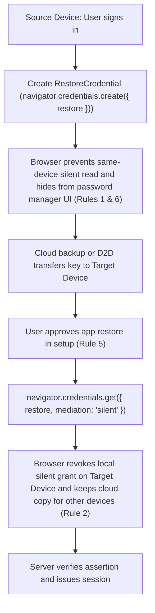

# Track 1 Deep-Dive: Dedicated RestoreCredential (and Passkey Alternatives)

**Prerequisite Reading:** This document references the problem, use cases, and six mandatory rules defined in the [Core Explainer](README.md). For the declarative network alternative, see [Track 2 Deep-Dive](track2-dbsc-session-restore.md).

## 1. Architectural Overview
Track 1 extends Credential Management and WebAuthn to restore installed web apps. It enforces the Six Mandatory Rules from the Core Explainer:
1. **Rule 1 (Write-Only on Source Device):** The browser blocks reading a restore key on the source device.
2. **Rule 2 (One-Time Silent Read per Device Restore):** The browser allows one silent read per target device restore. The cloud backup copy remains available to restore additional devices.
3. **Rule 3 (Strict Fate-Sharing with Site Data & Logout):** The browser treats the key as browsing data partitioned by browser and profile. It deletes the key when the user clears site data or logs out.
4. **Rule 4 (Authenticated Top-Level Context Only):** Only an authenticated top-level origin (`Set-Login: logged-in`) can enroll a restore key.
5. **Rule 5 (Explicit User Restore Consent):** The target device releases the key only after user restore consent.
6. **Rule 6 (Hidden from Password Manager UI):** The browser or OS stores the key strictly as a hidden backup key. It never shows the key in password manager UIs or autofill prompts.

### Primary Track 1 Design: Dedicated Backup-Only `RestoreCredential` (Option 1B)
The installed web app registers a dedicated, backup-scoped restore key (`navigator.credentials.create({ restore })`) after login.
* **Direct Browser or OS Restore Routing:** Standard passkeys route through OS credential brokers to third-party password managers (`App -> OS Credential Broker -> Password Manager`). By contrast, a dedicated `RestoreCredential` routes directly to the browser's restore store or the OS backup module. This keeps the key hidden from password manager UIs (Rule 6) and avoids third-party password manager dependencies.
* **One-Time Silent Read per Target Device:** After the user consents to restore the app on a target device, the browser unlocks a silent read. The app calls `navigator.credentials.get({ restore, mediation: "silent" })`. Calling `get()` consumes the one-time silent grant even if `allowCredentials` fails to match. The encrypted cloud backup copy remains available to restore additional devices until Rule 3 deletes it.
* **W3C Standardization Tradeoff:** Routing directly to the browser or OS backup subsystem is the most practical implementation path. However, W3C standards discussions may evaluate whether to support pluggable third-party credential providers.

## 2. WebIDL Specification
Track 1 (Option 1B) introduces a dedicated `RestoreCredential` dictionary and interface. User agents cap the optional `restorationPayload` at `2048` bytes so sites cannot back up raw cookies or bulk storage.

```webidl
dictionary RestoreCredentialCreationOptions {
    required USVString rpId;
    required BufferSource userId;
    required USVString userName;
    required BufferSource challenge;
    required sequence<PublicKeyCredentialParameters> pubKeyCredParams;
    // Capped at 2048 bytes to prevent raw cookie or bulk storage backup
    BufferSource restorationPayload;
};

dictionary RestoreCredentialRequestOptions {
    required USVString rpId;
    required BufferSource challenge;
    sequence<PublicKeyCredentialDescriptor> allowCredentials;
};

typedef object RestoreCredentialJSON;

[Exposed=Window, SecureContext]
interface RestoreCredential : Credential {
    readonly attribute USVString rpId;
    readonly attribute ArrayBuffer rawId;
    readonly attribute RestoreCredentialResponse response;
    RestoreCredentialJSON toJSON();
};

[Exposed=Window, SecureContext]
interface RestoreCredentialResponse : AuthenticatorResponse {
    // clientDataJSON is inherited from AuthenticatorResponse
    readonly attribute ArrayBuffer authenticatorData;
    readonly attribute ArrayBuffer? signature;
    readonly attribute ArrayBuffer? userHandle;
    readonly attribute ArrayBuffer? restoredPayload;
    ArrayBuffer? getPublicKey();
};

partial dictionary CredentialCreationOptions {
    RestoreCredentialCreationOptions restore;
};

partial dictionary CredentialRequestOptions {
    RestoreCredentialRequestOptions restore;
};
```

## 3. Client and Server JavaScript Flows
### Dedicated Backup-Only `RestoreCredential` (Option 1B)
```javascript
// 1. Source Device (Option 1B): Enroll write-only RestoreCredential post-login
async function enrollRestoreKey(user, seedPayload) {
  if (!window.RestoreCredential) {
    return;
  }
  const challenge = await fetchChallenge("/api/restore/challenge", user.id);
  const cred = await navigator.credentials.create({
    restore: {
      rpId: window.location.hostname,
      userId: new TextEncoder().encode(user.id),
      userName: user.email,
      challenge: challenge,
      pubKeyCredParams: [
        {
          type: "public-key",
          alg: -7
        }
      ],
      restorationPayload: new TextEncoder().encode(seedPayload)
    }
  });
  await registerWithServer(cred.toJSON());
}

// 2. Target Device (Option 1B): One-time silent read per restored device
// (The encrypted cloud backup copy remains available to restore other devices)
async function restoreSessionOnTargetDevice() {
  if (!window.RestoreCredential || !navigator.credentials?.get) {
    return false;
  }
  try {
    const challenge = await fetchChallenge("/api/restore/request-challenge");
    const assertion = await navigator.credentials.get({
      mediation: "silent",
      restore: {
        rpId: window.location.hostname,
        challenge: challenge
      }
    });
    const response = await claimSessionOnServer(assertion.toJSON());
    if (response.ok) {
      window.location.reload();
      return true;
    }
  } catch (err) {
    return false;
  }
}

// 3. Explicit User Logout (Rule 3)
async function handleUserLogout() {
  if (navigator.credentials?.preventSilentAccess) {
    await navigator.credentials.preventSilentAccess();
  }
  await fetch("/api/auth/logout", {
    method: "POST"
  });
  window.location.href = "/login";
}
```



## 4. Authenticator Data Flags & Attestation Semantics
In [WebAuthn Level 3](https://www.w3.org/TR/webauthn-3/), the `authenticatorData` flags communicate verification state. Passkeys and software or cloud restore keys do not use FIDO2 hardware attestation, so the browser and OS enforce restore state directly.
* **User Present (`UP = 0`):** Silent restore assertions emit `UP = 0`. Initial enrollment and target device unlock establish user presence.
* **User Verified (`UV`):** Set if biometric or PIN verification occurred during target device setup.
* **Backup Eligibility (`BE = 1`):** Credential creation sets `BE = 1` to designate restore eligibility.
* **Backup State (`BS`):** `BS = 1` indicates cloud restore. `BS = 0` indicates local cable or Wi-Fi transfer. Relying parties accept both states.

## 5. Testing Strategy: WPT Virtual Authenticator Extension
Hermetic testing in Web Platform Tests extends WebDriver virtual authenticators via `simulate_restore_credential_migration`:
* **Security Isolation:** The `simulate_restore_credential_migration` hook functions only on synthetic virtual authenticators. Physical authenticators reject this call.
* **Atomic State Transition:** The hook unlocks the one-time restore grant, applies user consent, and clears cookies.
```javascript
promise_test(async t => {
  const authId = await window.test_driver.add_virtual_authenticator({
    protocol: "ctap2",
    transport: "internal",
    supportsRestoreCredential: true
  });
  t.add_cleanup(() => {
    return window.test_driver.remove_virtual_authenticator(authId);
  });

  const createOpts = {
    rpId: location.hostname,
    userId: new Uint8Array([1]),
    userName: "user@example.com",
    challenge: new Uint8Array(16),
    pubKeyCredParams: [
      {
        type: "public-key",
        alg: -7
      }
    ],
    restorationPayload: new TextEncoder().encode("seed")
  };
  const getOpts = {
    mediation: "silent",
    restore: {
      rpId: location.hostname,
      challenge: new Uint8Array(16)
    }
  };

  await fetch("/common/set-login.py?state=logged-in");
  const cred = await navigator.credentials.create({
    restore: createOpts
  });
  assert_true(cred.response.getPublicKey().byteLength > 0);

  // 1. Rule 1: Same-device assertion before migration rejects
  await promise_rejects_dom(
    t,
    "NotAllowedError",
    navigator.credentials.get(getOpts)
  );

  // 2. Rule 2: Post-migration get() succeeds once per restored device,
  // revokes same-device silent repeat, and keeps cloud key for other devices
  await window.test_driver.simulate_restore_credential_migration(authId, {
    targetDeviceId: "device-b",
    userConsented: true,
    backupRestored: true
  });
  const assertionB = await navigator.credentials.get(getOpts);
  const restoredTextB = new TextDecoder().decode(
    assertionB.response.restoredPayload
  );
  assert_equals(restoredTextB, "seed");
  await promise_rejects_dom(
    t,
    "NotAllowedError",
    navigator.credentials.get(getOpts)
  );

  // Restoring a second device (device-c) from cloud backup also succeeds
  await window.test_driver.simulate_restore_credential_migration(authId, {
    targetDeviceId: "device-c",
    userConsented: true,
    backupRestored: true
  });
  const assertionC = await navigator.credentials.get(getOpts);
  assert_equals(
    new TextDecoder().decode(assertionC.response.restoredPayload),
    "seed"
  );

  // 3. Rule 3: preventSilentAccess() purges the restore grant/key
  await fetch("/common/set-login.py?state=logged-in");
  await navigator.credentials.create({
    restore: createOpts
  });
  await navigator.credentials.preventSilentAccess();
  await window.test_driver.simulate_restore_credential_migration(authId, {
    targetDeviceId: "device-d",
    userConsented: true,
    backupRestored: true
  });
  await promise_rejects_dom(
    t,
    "NotAllowedError",
    navigator.credentials.get(getOpts)
  );

  // 4. Rule 4: Unauthenticated state rejects create()
  await fetch("/common/set-login.py?state=logged-out");
  await promise_rejects_dom(
    t,
    "NotAllowedError",
    navigator.credentials.create({ restore: createOpts })
  );

  // 5. Rule 5: Unconsented migration rejects get()
  await fetch("/common/set-login.py?state=logged-in");
  await navigator.credentials.create({
    restore: createOpts
  });
  await window.test_driver.simulate_restore_credential_migration(authId, {
    targetDeviceId: "device-e",
    userConsented: false,
    backupRestored: true
  });
  await promise_rejects_dom(
    t,
    "NotAllowedError",
    navigator.credentials.get(getOpts)
  );
}, "Track 1: Restore lifecycle, six rules, and boundary isolation");
```

## 6. Considered Alternative: Option 1A (Reusing `PublicKeyCredential` or Passkey-Attached Extensions)
We also evaluated **Option 1A**, where the installed web app reuses `PublicKeyCredential`. The app calls `navigator.credentials.create({ publicKey, mediation: "conditional" })` or uses a passkey extension. On the restored target device, the browser grants a one-time permission for `navigator.credentials.get({ publicKey, mediation: "silent" })`.

### Why Option 1B (`RestoreCredential`) Is Preferred Over Option 1A
1. **`Conditional Create` Requires an Existing Saved Password:** [WebAuthn Conditional Create](https://developer.chrome.com/docs/identity/webauthn-conditional-create) upgrades an existing saved password into a passkey. It does not silently drop a backup credential for an arbitrary signed-in session (such as OAuth, SSO, or OTP login).
2. **Password Manager UI Visibility (Rule 6):** Standard passkeys appear in the user's password manager UI and autofill prompts. This violates Rule 6 for apps that only want an invisible session-restore key. If WebAuthn hides a backup-only passkey from the password manager UI, it becomes functionally equivalent to Option 1B (`RestoreCredential`).
3. **Password Manager Broker Dependencies:** An app could attach a restore key as a WebAuthn extension on a standard passkey (similar to `prf` or `largeBlob`). However, passkey requests route through `App -> OS Credential Broker -> Password Manager`. This requires every third-party password manager to implement and ship custom backup-only restore semantics.

### Option 1A JavaScript Flow (For Reference)
```javascript
// 1. Source Device (Option 1A): Register passkey via Conditional Create
async function enrollPasskeyForRestore(user) {
  const challenge = await fetchChallenge("/api/webauthn/challenge", user.id);
  const cred = await navigator.credentials.create({
    publicKey: {
      rp: {
        id: window.location.hostname,
        name: "Example Installed App"
      },
      user: {
        id: new TextEncoder().encode(user.id),
        name: user.email,
        displayName: user.displayName
      },
      challenge: challenge,
      pubKeyCredParams: [
        {
          type: "public-key",
          alg: -7
        }
      ]
    },
    mediation: "conditional"
  });
  await registerWithServer(cred.toJSON());
}

// 2. Target Device (Option 1A): Browser restore grant unlocks silent get() once
async function restoreWithPasskeyGrant() {
  try {
    const challenge = await fetchChallenge("/api/webauthn/request-challenge");
    const assertion = await navigator.credentials.get({
      publicKey: {
        rpId: window.location.hostname,
        challenge: challenge
      },
      mediation: "silent"
    });
    const response = await claimSessionOnServer(assertion.toJSON());
    if (response.ok) {
      window.location.reload();
      return true;
    }
  } catch (err) {
    return false;
  }
}
```
