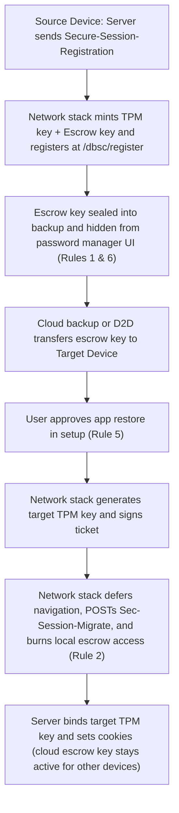

# Track 2 Deep-Dive: Declarative DBSC Restore (Sec-Session-Migrate)

**Prerequisite Reading:** This document references the problem, use cases, and six mandatory rules defined in the [Core Explainer](README.md). For the JavaScript `RestoreCredential` alternative, see [Track 1 Deep-Dive](track1-restore-credential.md).

## 1. Architectural Concept: Zero-JavaScript Session Migration
Track 2 extends [Device Bound Session Credentials (DBSC)](https://w3c.github.io/webappsec-dbsc/) inside the browser network stack to restore installed web apps. Standard DBSC binds sessions to non-exportable hardware keys in local TPM or Secure Enclave chips. This design prevents cookie theft, but terminates sessions when a user switches devices.

Track 2 resolves device migration without exposing any JavaScript APIs or DOM interfaces:
* **Zero JavaScript Surface:** Scripts cannot trigger, intercept, or inspect migration handshakes.
* **Immunity to XSS and Supercookies:** Malicious page scripts cannot mint tracking keys or exfiltrate private credentials.
* **Automatic Fate-Sharing & Browsing Data Partitioning:** Handled inside the network stack, migration keys are browsing data partitioned by browser and profile. They share the exact lifecycle of browser cookies and site data.

## 2. Declarative Migration-Escrow Lifecycle
Track 2 manages session migration across four declarative steps:
1. **Enrollment (Pre-Staged Migration Escrow Key):** During login, the server sends `Secure-Session-Registration` pointing to `/dbsc/register`. In the registration JSON response, the server sets `"migrate_allowed": "d2d_only"` or `"cloud_and_d2d"` and a required `"account_hint"` for the restore UI whenever migration is enabled. Alongside the primary hardware key, the browser creates a write-only **Migration Escrow Keypair**. The browser registers the escrow public key with the server and stores the private key in the browser or OS backup vault.
2. **Target Key Generation:** When a target device restores the app, the browser checks user consent. It then generates a fresh hardware key in the target device TPM. The restored escrow key signs a CBOR/JWS **Migration Authorization Ticket** binding the new hardware key to a session.
3. **Declarative Network Handshake via `refresh_url`:** When the user opens the restored installed web app, the browser network stack defers navigation. It issues a `POST` request to `refresh_url` containing the `Sec-Session-Migrate` header with the escrow ticket and proof-of-possession. The browser revokes local escrow access on that device the moment it transmits `Sec-Session-Migrate` on the wire. Meanwhile, the encrypted escrow key in cloud backup remains available to restore additional devices.
4. **Server Session Re-Binding:** The server verifies the ticket and binds a session to the target hardware key. For cloud backup (`"cloud_and_d2d"`), the server retains the escrow public key so the user can restore multiple devices from cloud backup until logout. For strict 1:1 cable transfers (`"d2d_only"`), the server may rotate or burn the escrow key after one claim. When a user logs out, the server revokes all escrow keys.

## 3. HTTP Exchanges & Lifecycle Diagram
### (a) Source Device: Session Registration with Migration Escrow
```http
POST /auth/login HTTP/1.1
Host: example.com

HTTP/1.1 200 OK
Set-Cookie: session_token=tok_init_123; Secure; HttpOnly; SameSite=Lax
Secure-Session-Registration: (ES256); path="/dbsc/register"; challenge="reg_chal_991a"
Set-Login: logged-in
```

The browser then registers its primary TPM public key and migration escrow public key at `/dbsc/register`, and the server returns the session configuration JSON:

```http
POST /dbsc/register HTTP/1.1
Host: example.com
Secure-Session-Response: <JWT proof of primary TPM key and escrow key>

HTTP/1.1 200 OK
Content-Type: application/json

{
  "session_identifier": "s_984f2b1a",
  "refresh_url": "/dbsc/refresh_session",
  "migrate_allowed": "cloud_and_d2d",
  "account_hint": "user@example.com"
}
```

### (b) Target Device: Deferred Navigation & `refresh_url` Handshake
```http
POST /dbsc/refresh_session HTTP/1.1
Host: example.com
Sec-Secure-Session-Id: s_984f2b1a
Sec-Session-Migrate: escrow_sig="base64_sig", new_key="base64_spki", new_key_pop="base64_pop"

HTTP/1.1 200 OK
Set-Cookie: session_token=tok_fresh_7721; Secure; HttpOnly; SameSite=Lax
Set-Login: logged-in
Content-Type: application/json

{
  "session_identifier": "s_984f2b1a",
  "refresh_url": "/dbsc/refresh_session",
  "migrate_allowed": "cloud_and_d2d",
  "account_hint": "user@example.com"
}
```



## 4. Enforcement of the Six Mandatory Rules
Track 2 maps the Six Mandatory Rules directly into network stack invariants:
* **Rule 1 (Write-Only on Source Device):** The escrow key remains sealed for backup transfer only. The network stack never uses the escrow key for routine session refreshes on the source device.
* **Rule 2 (One-Time Silent Read per Device Restore):** The target browser consumes its one-time restore grant the moment it transmits `Sec-Session-Migrate` on the wire. This prevents a malicious server from aborting responses to replay `Sec-Secure-Session-Id`. Meanwhile, the encrypted escrow key in cloud backup remains valid until logout.
* **Rule 3 (Strict Fate-Sharing with Site Data & Logout):** Installed web apps share state with the browser. Therefore, the escrow key is browsing data partitioned by browser and profile. Clearing cookies in browser UI or receiving [`Clear-Site-Data`](https://www.w3.org/TR/clear-site-data/) or [`Set-Login: logged-out`](https://w3c-fedid.github.io/login-status/) purges all active session and escrow keys instantly. This prevents silent re-login on both the same device and a restored device.
* **Rule 4 (Authenticated Top-Level Context Only):** Sessions enroll only over secure contexts during authenticated server exchanges (`Set-Login: logged-in`). `Sec-Session-Migrate` fires only on unauthenticated top-level installed app navigations. It never fires in cross-origin iframes, background subresource fetches, or over an already-signed-in target session.
* **Rule 5 (Explicit User Restore Consent):** The browser dispatches `Sec-Session-Migrate` only if the user approved the app in the restore UI.
* **Rule 6 (Hidden from Password Manager UI):** The browser network stack manages the DBSC migration escrow key. It never appears in password manager UIs or autofill prompts.

## 5. Testing Strategy: WPT Network Simulation & Pure HTTP Ergonomics
### WPT Network Simulation Hook
Web Platform Tests extend WebDriver with a simulation command: `window.test_driver.simulate_dbsc_device_migration(origin, { targetDeviceId, userConsented: true })`.

```javascript
promise_test(async t => {
  // 1. Establish DBSC session on Source Device with cloud + D2D migration
  await setupShardedServerState();
  const regRes = await fetch("login.py?migrate_allowed=cloud_and_d2d");
  assert_equals(regRes.status, 200, "Device A DBSC session established");

  // 2. Rule 5 & Rule 2: Simulate cloud restore onto Target Device B
  await window.test_driver.simulate_dbsc_device_migration(
    window.location.origin,
    { targetDeviceId: "device-b", userConsented: true }
  );

  // Top-level navigation triggers deferred Sec-Session-Migrate and binds TPM
  const popupB = window.open("app_launch.html");
  await waitForLoad(popupB);
  popupB.close();
  const restoredResB = await fetch("verify_authenticated.py");
  assert_equals(
    restoredResB.status,
    200,
    "Device B session restored via Sec-Session-Migrate"
  );

  // 3. Rule 2 (Multi-Device Cloud Restore): Restoring onto Target Device C
  // also succeeds because the cloud backup escrow key is retained
  await window.test_driver.simulate_dbsc_device_migration(
    window.location.origin,
    { targetDeviceId: "device-c", userConsented: true }
  );
  const popupC = window.open("app_launch.html");
  await waitForLoad(popupC);
  popupC.close();
  const restoredResC = await fetch("verify_authenticated.py");
  assert_equals(
    restoredResC.status,
    200,
    "Device C session also restored from cloud escrow key"
  );

  // 4. Rule 5: Migration without user consent is blocked
  await window.test_driver.simulate_dbsc_device_migration(
    window.location.origin,
    { targetDeviceId: "device-d", userConsented: false }
  );
  const popupD = window.open("app_launch.html");
  await waitForLoad(popupD);
  popupD.close();
  const unconsentedRes = await fetch("verify_authenticated.py");
  assert_equals(
    unconsentedRes.status,
    401,
    "Unconsented migration blocked by network stack"
  );
}, "Track 2 DBSC: Declarative multi-device cloud restore and consent enforcement");
```

### Pure HTTP Developer Ergonomics
Developers inspect `Secure-Session-Registration` and `Sec-Session-Migrate` directly in standard browser Network panels. Backend teams test endpoints using standard tools:

```bash
curl -X POST "https://example.com/dbsc/refresh_session" \
  -H "Sec-Secure-Session-Id: s_984f2b1a" \
  -H 'Sec-Session-Migrate: escrow_sig="...", new_key="...", new_key_pop="..."'
```
